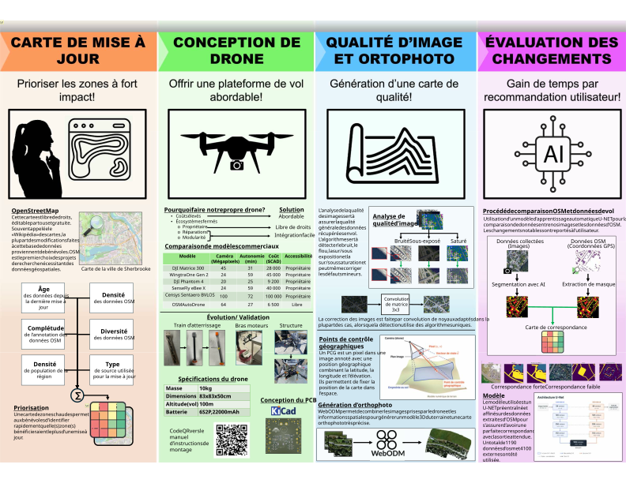

# Projet OSM Auto Drone
Ce projet vise à rendre la cartographie plus accessible à tous!

## Extentions QGIS
### Priorisation de zone de vol
Indicateur de priorisation de zone à mettre à jour : [OSM Heatmap Priotrity](https://github.com/OSMAutoDrone/osm_heatmap_priority)

### Détection de changement
Détection des changement entre un geotiff et les données OSM : [OSM Change AI analysis](https://github.com/OSMAutoDrone/AI_analysis)

## Extention WebODM
Automatisation de génération de PCG : [GCP extractor](https://github.com/OSMAutoDrone/OSMAutoDrone-GCP-Extractor)

## Rpanion-server personnalisé
Serveur de configuration de l'ordinateur companion : 
*contient aussi l'intégration de l'analyse de qualité d'images (IQA)

## Guides pour le drone OSM Auto Drone
Guides de montages, démontages et configuration du drone : [Guide OSMAD](https://osmautodrone.github.io/drone_instructions/)
